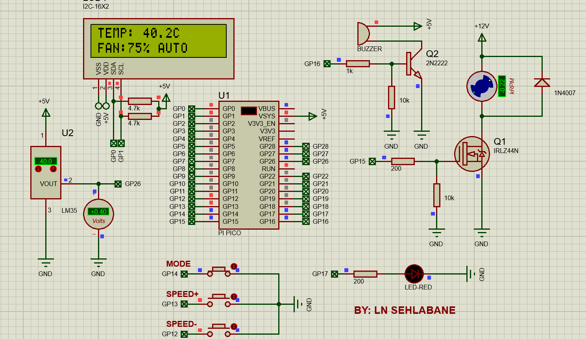

# Raspberry Pi Pico — Smart Temperature-Controlled Fan (Proteus 8)

**Simulation of a MicroPython-based temperature-controlled DC fan system**, developed by **L.N. Sehlabane**.

The design combines a Raspberry Pi Pico (RP2040), LM35 analog temperature sensor, four-wire I²C 16×2 LCD, PWM MOSFET fan driver, three pushbuttons, red alarm LED, and transistor-driven buzzer. The submitted Proteus project contains the tested simulation schematic and embedded MicroPython firmware.

> **Project status:** Working **Proteus simulation**, with screenshots at approximately 30°C, 40°C and 51°C. The project is documented as a **simulation only**. PCB routing, PCB fabrication, and physical assembly are outside the scope of this repository.



## Features

- LM35 ADC temperature measurement on Pico **GP26**.
- Automatic PWM fan control through **GP15** and IRLZ44N MOSFET.
- I²C 16×2 display on **GP0 SDA / GP1 SCL**, detected at address **0x3F**.
- Manual mode toggle and speed adjustment using three pushbuttons.
- High-temperature alarm: LED on **GP17**, buzzer control on **GP16**, 100% fan duty.
- Alarm thresholds: **ON at 50°C**, **OFF at 49°C**, providing hysteresis.
- Firmware scheduling targets: 50 ms sensor updates and 150 ms LCD updates, subject to simulator performance.

## Automatic fan logic

| LM35 temperature | PWM duty cycle |
|---|---:|
| Below 30°C | 0% |
| 30–34.9°C | 30% |
| 35–39.9°C | 50% |
| 40–44.9°C | 75% |
| 45°C and above | 100% |

At 50°C or above, the alarm activates and the fan is commanded to 100%; normal alarm reset occurs at 49°C or below. These percentages represent commanded PWM duty cycle, **not measured fan RPM**.

## Pico pin assignments

| Function | GPIO | Physical Pico header pin |
|---|---|---:|
| LCD SDA | GP0 | 1 |
| LCD SCL | GP1 | 2 |
| SPEED− | GP12 | 16 |
| SPEED+ | GP13 | 17 |
| MODE | GP14 | 19 |
| Fan MOSFET gate drive | GP15 | 20 |
| Buzzer transistor drive | GP16 | 21 |
| Alarm LED | GP17 | 22 |
| LM35 output | GP26 / ADC0 | 31 |
| Pico power input | VSYS | 39 |

## Repository contents

```
Proteus/       Original .pdsprj project, preserved unchanged
Firmware/      main.py, extracted from the submitted Proteus project
Images/        Three simulation screenshots showing operating states
Documentation/ Simulation notes, test observations and hardware considerations
```

## Run the simulation

1. Install a compatible **Proteus 8 Professional** edition with the Raspberry Pi Pico / MicroPython simulation capability.
2. Open `Proteus/Smart_Temperature-Controlled-Fan-System.pdsprj`.
3. In the Proteus firmware editor, verify that the Pico uses the bundled `main.py`. A standalone copy is also provided under `Firmware/`.
4. Start simulation and change the LM35 virtual temperature control.
5. Observe the LCD, PWM fan motor and alarm behavior at the various temperatures.
6. Test MODE, SPEED+ and SPEED− buttons separately in manual mode.

If your Proteus installation does not resolve the firmware path automatically, copy the contents of `Firmware/main.py` to the project's Pico MicroPython source file.

## Results

| Screenshot | LM35 setting | LCD display | Interpretation |
|---|---:|---|---|
| `01_30C_Auto.png` | 30.0°C | 30.5°C, FAN:30% AUTO | Automatic low-speed operation |
| `02_40C_Auto.png` | 40.0°C | 40.2°C, FAN:75% AUTO | Automatic higher-speed operation |
| `03_51C_Alarm.png` | 51.0°C | 51.2°C, FAN:100% ALARM | Overtemperature alarm state |

Simulation readings have small offsets relative to the LM35's programmed temperature. No physical accuracy or timing measurements are claimed.

## Hardware considerations (not implemented)

**This repository is a simulation-only demonstration, not PCB fabrication documentation.** Before transferring the schematic to real hardware:

- The simulated **5 V pull-ups on LCD SDA and SCL must not connect directly to Pico GPIO pins**; Pico GPIO is 3.3 V. Use a suitable level shifter or verified 3.3 V-compatible interface.
- Use a properly regulated supply for Pico VSYS and a suitable regulator when powered from 12 V. Respect Pico USB/external-power requirements.
- Size the motor tracks, MOSFET cooling and diode or suppression circuitry for the actual fan characteristics; brushed motors and brushless DC fans may require different protection arrangements.
- Verify audible buzzer performance and manual button operation on the intended platform.

## Author

**L.N. Sehlabane** — Electrical Engineering / Embedded Systems project.
